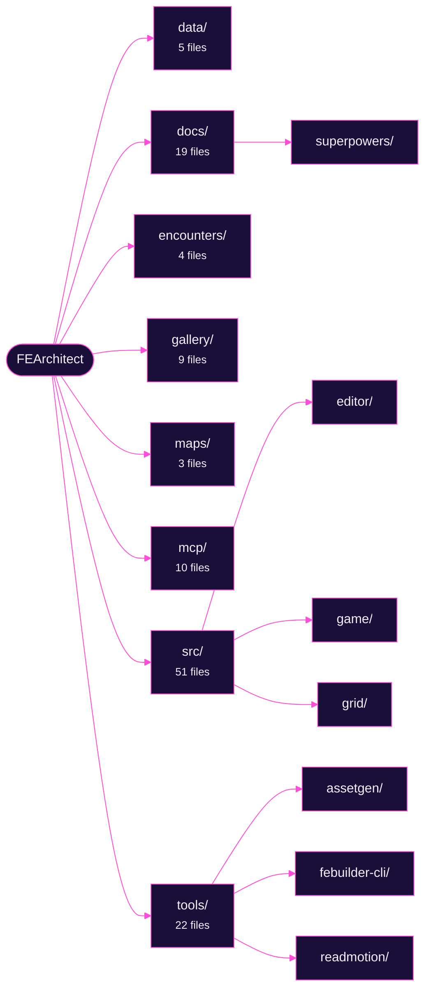
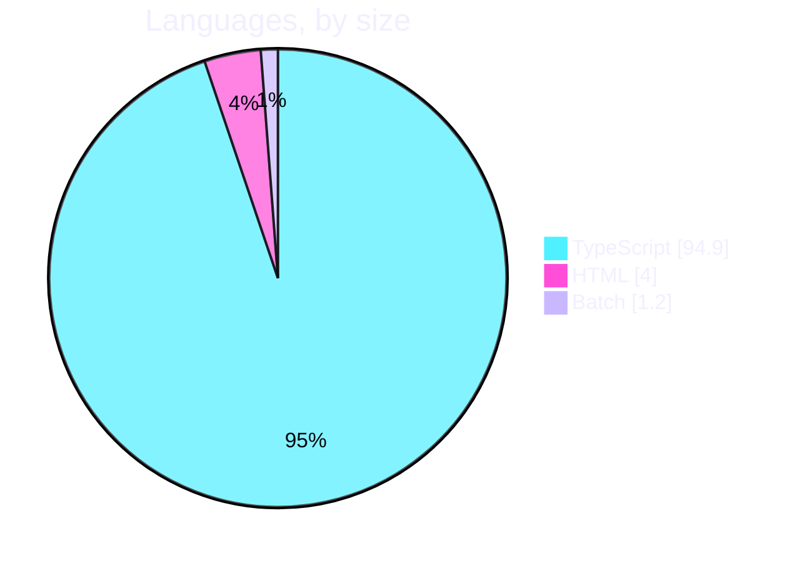

# FEArchitect

  
  
  
  

  <a href="#what-it-does">What it does</a> ·
  <a href="#roadmap">Roadmap</a>

### A sandbox for designing Fire Emblem 8 encounters

**Work in progress.** FEArchitect is an early, personal sandbox for designing FE8 encounters: fight math ported from the decomp, a small tactical grid to play scenarios on, and a reference gallery built from your own ROMs.

It is groundwork, not a finished tool. The long-term goal is editing FE8 maps and scenarios with an MCP server as the authoring assistant; none of that write path exists yet.

> [!NOTE]
> This project is a work in progress and is not ready to use as a tool. Features are incomplete, data formats change without notice, and nothing here writes to a ROM yet.

## What it does

- **Fight math from the decomp.** Hit, damage, crit and doubling follow the fireemblem8u source, including the 2RN hit model, so a duel previews the way the game would roll it.
- **A tactical grid to try scenarios on.** Multi-unit scenarios on a terrain grid, with class-based movement, an aggressive enemy AI and seeded auto play to rerun a fight exactly.
- **A reference gallery from your ROMs.** Units, classes, items, portraits, battle animations and chapter maps, imported locally from clean ROMs you supply. Nothing from the games is in this repo.
- **One operations layer, three ways in.** The same reads, edits, previews and simulations through a CLI, an MCP server for Claude, or a local Ollama bridge.

## Requirements

Node.js 24 or newer (it runs the TypeScript directly, no build step). Check with
`node --version`.

## Use it

- Double-click **Open Editor.cmd** to open the editor in your browser. Edit unit
  stats and weapons on the left, watch the fight math update on the right, and
  click Save to write your changes back into the config files.
- Double-click **Preview.cmd** to print the fight math for the baseline duel
  without opening a browser.
- Double-click **Test.cmd** to run the test suite.

### Map skirmish (Slice B)

- Double-click **Play Map.cmd** to open the 1v1 tactical grid in your browser.
  Move your unit within its highlighted range (movement depends on its class and
  the terrain), click a tile to preview the path, click again to confirm a move,
  or click an adjacent enemy to attack. Use "End turn" to pass to the enemy, the
  "Player type" selector to compare foot, cavalry, and flying movement, and
  "auto play player" to watch the whole fight run itself from the seed.

Grid data lives in `data/terrain.json`, `data/classes.json`, `maps/*.json`, and
`encounters/skirmish-01.json`.

## Where the data lives

- `data/units.json`: unit stats.
- `data/weapons.json`: weapon stats.
- `encounters/duel-01.json`: which units and weapons face off.

You can edit these by hand, but the editor is the easy path and it validates as
it loads.

## What this does and does not tell you

The math preview is authoritative for encounter pacing and difficulty only. It is
not authoritative for engine behavior: animations, menus, skill interactions, and
crashes are decided by a real ROM build, which is a later tier of this project.

## MCP server, CLI, and local bridge

FEArchitect has a shared operations layer (`mcp/handlers.ts`) exposed three ways.

### CLI (no AI, always available)

Run commands directly, for example:

    node mcp/cli.ts list units
    node mcp/cli.ts preview duel-01 --seed 42
    node mcp/cli.ts simulate skirmish-01 --seed 5
    node mcp/cli.ts set-unit eirika-t str=12 spd=16

Or double-click `Preview (CLI).cmd` and `Simulate.cmd`.

### MCP server (for Claude)

One-time: `cd mcp && npm install`. The repo's `.mcp.json` registers the server,
so running Claude Code in this folder makes the tools available after you approve
the server once. Then you can ask in natural language to read, edit, preview, and
simulate.

### Local bridge (natural language with a local model, no cloud)

One-time: install Ollama (ollama.com) and run `ollama pull qwen2.5`. Then
double-click `Bridge.cmd` (or `node mcp/bridge.ts`) and type requests like
"raise Eirika's speed to 17 and simulate the skirmish". Set `FEA_OLLAMA_MODEL` or
`FEA_OLLAMA_HOST` to use a different model or endpoint.

## Combat formulas

Ported from the fireemblem8u decomp (`src/bmbattle.c` ComputeBattleUnit
functions and `include/bmbattle.h`), including the two random number (2RN) hit
model and the attack speed difference of 4 needed to double. See comments in
`src/combat.ts` and `src/rng.ts` for the exact citations.

## FE asset gallery

Browse the GBA Fire Emblem canon (units, classes, items, portraits, battle
animations) imported from your clean ROMs.

One-time setup:
- Install the `FEBuilderGBA.CLI` (laqieer fork release, the `cli-win-x64` asset)
  into `tools/febuilder-cli/`.
- Place clean ROMs in `base/`: `FE8_Clean.gba`, and optionally `FE6_clean.gba`
  and `FE7_clean.gba`. These and the imported assets are gitignored.

Then:
- Double-click **Import Assets.cmd** to import every game whose ROM is present.
- Double-click **Gallery.cmd** to open the gallery. Pick a game, browse the tabs
  (Units show class names; Classes and Items have a Cards or Table toggle, and in
  Table view hovering a cell shows the column name, the value, and a decoded reading
  such as a weapon rank letter). On the Animations tab, search the id picker by
  class name (each option has a thumbnail) or step with Prev and Next to see all 12
  battle sections as labeled GIFs, and use Zoom to enlarge the tiles. Each GIF is
  generated on first view and cached.
- Double-click **Cache Animations.cmd** (optional) to pre-generate every battle
  animation up front so the Animations tab is instant. It is safe to re-run: it
  skips anything already cached. The cache lives under `assets/reference/` and is
  gitignored.
- Double-click **Generate Maps.cmd** to render every FE8 chapter map into the
  gallery, then browse them under the Maps tab (searchable by chapter name, with a
  zoom). Images are cached under `assets/reference/` and are gitignored. The maps are
  composited from the ROM tileset, tile arrangement, and palette; see
  `docs/superpowers/notes/fe8-map-format.md` for the format.

## How it's built

<b>The project in numbers</b>

| | |
| --- | --- |
| **What it is** | A command line project |
| **Written in** | TypeScript (94.9%), HTML (4%), Batch (1.2%) |
| **Version** | `0.0.1` |
| **Run it with** | `Bridge.cmd` · `Cache Animations.cmd` · `Gallery.cmd` · `Generate Maps.cmd` |
| **Size** | 139 files, 97 commits since 2026-09-09 |

## Roadmap

- [x] Tier 1 duel math preview
- [x] Tactical grid skirmish and multi-unit scenarios
- [x] Asset gallery and FE8 chapter map rendering
- [ ] Unit and enemy placements, and an encounter browser
- [ ] A unit editor and a starter skills system
- [ ] Writing maps, data and events back to a ROM
- [ ] MCP-assisted authoring of maps and scenarios
